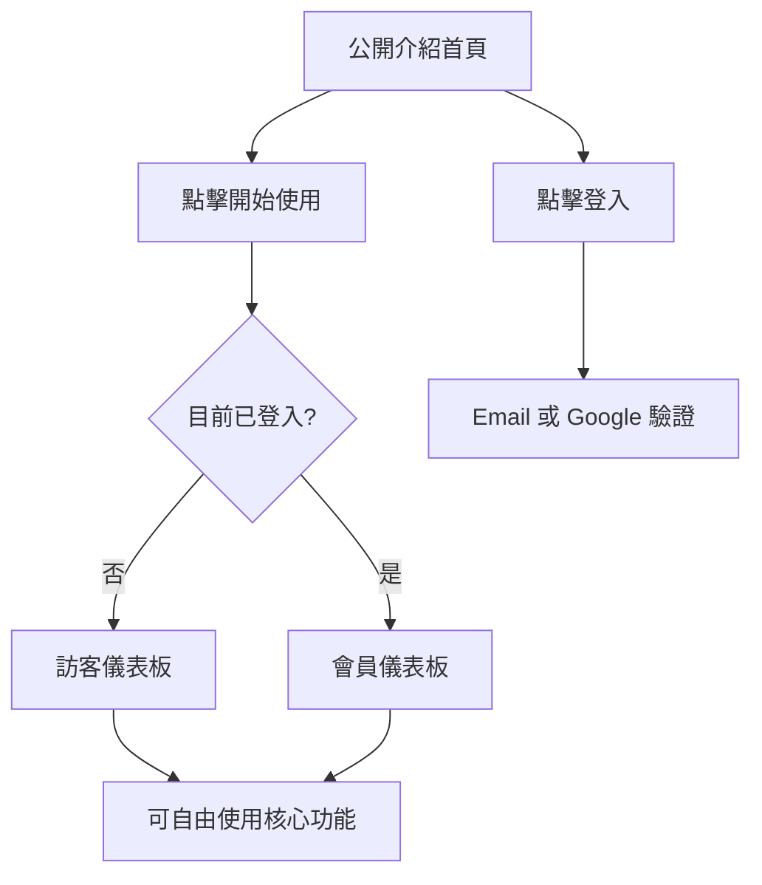
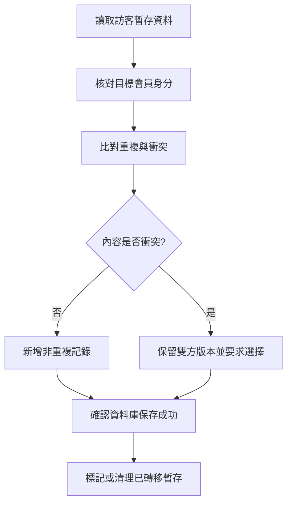

# ApplyMate AI — 核心使用流程 v1

> 本頁保留完整產品預期流程；v0.1 已實作訪客入口與個人資料填寫，其餘未實作，驗證以 progress.md 為準。

## 1. 進入平台

首度進儀表板顯示可跳過的新手任務清單，不跳強制表單。

## 2. Email 註冊與身分驗證

1. 使用 Email 註冊並建立帳號；可先登入。
2. 未驗證期間可使用全部核心功能，但正式資料先留在目前瀏覽器。
3. 使用者透過收到的驗證信完成驗證。
4. 啟用平台資料庫保存權限；安全轉移本瀏覽器暫存資料。
5. 成功後才移除已完成同步的暫存資料。

Google 身分驗證需核實由可信任 OAuth/OIDC 取得的信箱驗證狀態。寄送驗證信的服務、權杖期限等尚待技術決定。

## 3. 訪客資料併入會員

禁止用暫存內容無條件覆蓋會員原有資料；需考慮資料轉移失敗重試、重複匯入防護及回滾。具體衝突介面尚待 UI 詳化。

## 4. 個人資料填寫

1. 選擇九大分類任一項。
2. 手動新增或編輯；輸入期間自動保存草稿。
3. 按「儲存資料」正式提交。
4. 重開編輯頁可恢復未送出的草稿。
5. 基本資料完成度依五項必要欄位計算，其餘選填。

## 5. AI 文件匯入

1. 上傳文字型 PDF、DOCX、TXT。
2. 解析文字並由 AI 分類為九大類候選資料。
3. 使用者看分類預覽，可勾選／修改。
4. 系統比對舊資料：相同預設略過、有差異顯示衝突。
5. 使用者選擇保留、更新、另建或合併。
6. 確認後才寫入正式個人資料。

## 6. 文件生成（優先校系客製化）

1. 使用者進入備審文件頁，選擇客製化模式。
2. 連結已建立的學校申請紀錄／校系目標；尚未建立時如何新增須後續定義。
3. 檢視已有個人資料，顯示重要缺漏資訊。
4. 使用者選擇直接生成或先補充。
5. 後端呼叫候選 AI Provider，依已確認資料產生草稿，明確標示待確認項。
6. 使用者編輯、確認，保存並關聯申請學校；具體匯出流程待定。

## 7. 學校申請管理與提醒

1. 使用者建立學校／系所／組別申請紀錄並輸入事件日期。
2. 手動變更申請狀態、備取與報到等結果。
3. 系統計算統計摘要與日期提醒（前 7 天、前 1 天、當天）。
4. 所有人在網站內看到提醒；已驗證會員才由背景排程寄送 Email。
5. 事件日期修改、取消或完成後，更新未發送的提醒；避免重複發送。

**限制**：訪客資料只在瀏覽器；訪客關閉網站後不會有 Email 或已確認的背景推播。公開部署的 Email 提醒需要獨立可靠的後端排程。

## 8. AI 模擬面試（高階流程，細節待定）

1. 使用者選擇練習目標或申請方向。
2. 系統生成起始問題。
3. 根據回答動態追問。
4. 提供具體改善建議，不強制評分。
5. 可否保存歷次問答／語音等詳細選項待確定。
